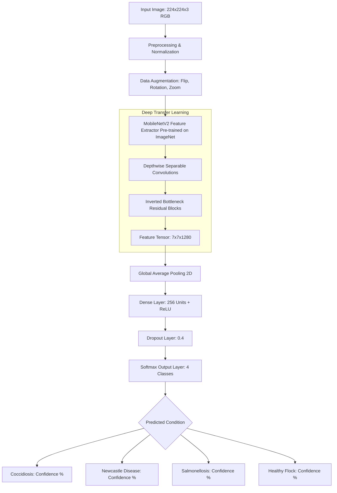

# Transfer-Learning-Based Classification of Poultry Diseases for Enhanced Health Management                  

> **AI-Powered Avian Pathology Classification & Health Management System** using **MobileNetV2 Transfer Learning**, **Deep Convolutional Neural Networks**, and an interactive diagnostic web portal for early disease detection, clinical analysis, and biosecurity intervention.

[](https://prabhavathi11-code.github.io/Transfer-Learning-Based-Classification-of-Poultry-Diseases-for-Enhanced-Health-Management/)
[](https://github.com/prabhavathi11-code/Transfer-Learning-Based-Classification-of-Poultry-Diseases-for-Enhanced-Health-Management)
[](https://github.com/prabhavathi11-code/Transfer-Learning-Based-Classification-of-Poultry-Diseases-for-Enhanced-Health-Management)
[](https://github.com/prabhavathi11-code/Transfer-Learning-Based-Classification-of-Poultry-Diseases-for-Enhanced-Health-Management)
[](https://python.org)

---

### 🌐 **Live Deployed Web Application:**  
👉 **[https://prabhavathi11-code.github.io/Transfer-Learning-Based-Classification-of-Poultry-Diseases-for-Enhanced-Health-Management/](https://prabhavathi11-code.github.io/Transfer-Learning-Based-Classification-of-Poultry-Diseases-for-Enhanced-Health-Management/)**

---

## 📌 Project Overview

Poultry health management is vital to the poultry industry and global food security. Acute infectious poultry diseases—including **Coccidiosis**, **Newcastle Disease**, and **Salmonellosis**—can spread rapidly through whole flocks within 48 to 72 hours, causing severe mortality and economic loss if not detected early.

**PoultryDetect** utilizes **Transfer Learning** via a pre-trained **MobileNetV2** backbone fine-tuned on labeled poultry disease datasets (~7,000 images from Roboflow). This provides an accessible, high-accuracy computer vision tool for farmers, veterinary students, and farm managers to classify poultry health conditions quickly through visual image input.

---

## 🚀 Key Features

* **Multi-Class Disease Classification:** Detects and classifies 4 conditions:
  * **Coccidiosis** (Intestinal protozoan infection)
  * **Newcastle Disease** (Highly contagious viral infection)
  * **Salmonellosis / Pullorum** (Bacterial systemic infection)
  * **Healthy Flock** (Optimal baseline avian condition)
* **Real-Time Client Inference:** Instant image diagnosis directly in the web browser with confidence metrics and multi-class distribution.
* **Clinical Treatment Guidance:** Provides target organ pathology details, recommended medications (e.g., Amprolium, Toltrazuril, Enrofloxacin), and immediate biosecurity isolation protocols.
* **Pre-Loaded Specimen Presets:** 1-click test images for each disease category for quick evaluation and demonstration.
* **Comprehensive Pathology Knowledgebase:** Clinical guide detailing transmission vectors, incubation periods, visible symptoms, and prevention tips.
* **Automated Diagnostic Reports:** Downloadable summary reports (`.txt`) for farm record-keeping and veterinary consultations.
* **Dual Deployment:** Zero-setup client-side deployment on **GitHub Pages**, plus local execution with **Flask & Python**.

---

## 🧬 Disease Pathology & Clinical Guide

| Disease Condition | Pathogen Type | Visible Symptoms | Transmission Vector | Veterinary Treatment & Protocol |
| :--- | :--- | :--- | :--- | :--- |
| **Coccidiosis** | Protozoan (*Eimeria spp.*) | Bloody droppings, ruffled feathers, hunched posture, weight loss | Ingestion of sporulated oocysts in wet litter or feed | **Amprolium** (0.024% in drinking water for 5 days) or **Toltrazuril**; replace damp bedding. |
| **Newcastle Disease** | Viral (*Avian Paramyxovirus APMV-1*) | Twisted neck (torticolis), gasping, coughing, greenish diarrhea, paralysis | Aerosol droplet inhalation, bodily secretions, wild birds | **Immediate pen quarantine**; electrolyte supportive therapy; routine *LaSota* vaccination for unaffected birds. |
| **Salmonellosis / Pullorum** | Bacterial (*Salmonella enterica*) | Chalky white vent pasting, somnolence, huddling, breathing difficulty | Transovarian (vertical) or via contaminated feed & rodents | **Enrofloxacin** or **Amoxicillin** in water; antiseptic vent cleaning; water chlorination. |
| **Healthy Condition** | Baseline Physiological Standard | Bright red comb & wattles, clear round eyes, active foraging, firm stool | N/A | Provide ad libitum clean water, balanced feed (18-20% crude protein), and regular biosecurity footbaths. |

---

## ⚙️ Model Architecture & Methodology



* **Backbone:** MobileNetV2 pre-trained on ImageNet, utilizing inverted residuals and linear bottlenecks.
* **Dataset:** Roboflow Poultry Disease dataset (~7,000 images in JPEG format, 224×224 resolution).
* **Head:** Global Average Pooling 2D $\rightarrow$ Dense(256, ReLU) $\rightarrow$ Dropout(0.4) $\rightarrow$ Dense(4, Softmax).
* **Loss Function:** Categorical Cross-Entropy.

---

## 💻 Local Setup & Running Instructions

### Option 1: Run Web Portal Locally (No Installation Required)
Simply clone the repository and open `index.html` in your web browser:
```bash
git clone https://github.com/prabhavathi11-code/Transfer-Learning-Based-Classification-of-Poultry-Diseases-for-Enhanced-Health-Management.git
cd Transfer-Learning-Based-Classification-of-Poultry-Diseases-for-Enhanced-Health-Management
```
Double-click `index.html` to launch the application.

### Option 2: Run with Python & Flask Backend
1. Clone the repository and navigate into the folder:
   ```bash
   git clone https://github.com/prabhavathi11-code/Transfer-Learning-Based-Classification-of-Poultry-Diseases-for-Enhanced-Health-Management.git
   cd Transfer-Learning-Based-Classification-of-Poultry-Diseases-for-Enhanced-Health-Management
   ```

2. Create a virtual environment and activate it:
   ```bash
   python -m venv venv
   # On Windows:
   venv\Scripts\activate
   # On Linux/macOS:
   source venv/bin/activate
   ```

3. Install requirements:
   ```bash
   pip install -r requirements.txt
   ```

4. Run the Flask application:
   ```bash
   python app.py
   ```
   Open `http://localhost:5000` in your browser.

---

## 📁 Repository Structure

```text
├── .github/
│   └── workflows/
│       └── deploy.yml              # GitHub Pages deployment workflow
├── static/
│   ├── coccidiosis.jpeg            # Sample specimen: Coccidiosis
│   ├── hen-healthy.jpeg            # Sample specimen: Healthy hen
│   ├── poultry-farm.jpeg           # Sample specimen: Salmonella
│   └── sick-chicken.jpeg           # Sample specimen: Newcastle Disease
├── Templates/
│   ├── index.html                  # Flask home page template
│   ├── predict.html                # Flask prediction view template
│   ├── blog.html                   # Blog articles template
│   ├── blog-single.html            # Article detail template
│   └── portfolio-details.html      # Project details view template
├── documents/
│   ├── Poultrydisease_Project.pdf  # Project dossier & specifications
│   └── workflow.txt                # Engineering methodology notes
├── videodemo/
│   └── Recording 2025-07-01.mp4    # Video demonstration
├── app.py                          # Flask application server
├── dashboard.html                  # Diagnostic studio page
├── index.html                      # Main deployed interactive web application
├── requirements.txt                # Python dependencies
└── README.md                       # Comprehensive project documentation
```

---

## 📄 License & Attribution

This project is licensed under the open-source community standards for education, agricultural research, and veterinary health management.
